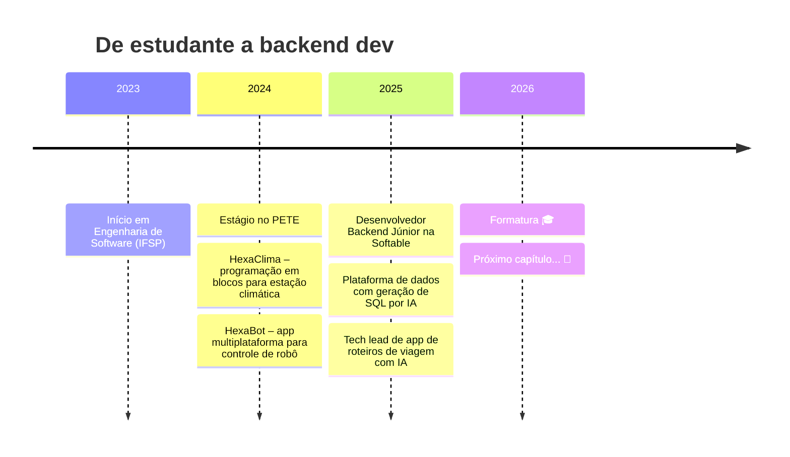

<!-- ===================== BANNER ===================== -->


<p align="center">
  <a href="https://git.io/typing-svg">
    
  </a>
</p>

<p align="center">
  <a href="https://linkedin.com/in/lucaspereiradossantos"></a>
  <a href="mailto:lucasspereirasantos05@gmail.com"></a>
</p>

---

### 🧑‍💻 `GET /api/lucas`

```csharp
public sealed class Lucas : BackendDeveloper
{
    public string Location   => "São Carlos, SP 🇧🇷";
    public string Role       => "Backend Developer @ Softable";
    public string Education  => "Engenharia de Software @ IFSP (2023–2026)";
    public int    YearsOfXp  => 2;

    public string[] Stack => [ "C#", "ASP.NET Core", "Java", "Spring Boot",
                               "PostgreSQL", "MongoDB", "Redis", "Docker", "AWS" ];

    public string[] Mindset => [ "TDD", "SOLID", "Clean Code", "CI/CD" ];

    public string CurrentlyBuilding =>
        "Plataforma de dados que transforma linguagem natural em SQL e dashboards com IA";

    public Task<Coffee> RefuelAsync() => Kitchen.BrewAsync(strength: Strength.Max);
}
```

---

### 🗺️ Minha jornada



---

### 🛠️ Tech Stack

<p align="center">
  <br/>
  
</p>

---

<details>
<summary><b>📡 Clique para fazer um request na minha experiência</b></summary>

```http
GET /api/lucas/experience HTTP/1.1
Host: github.com
```

```json
{
  "status": 200,
  "data": [
    {
      "company": "Softable",
      "role": "Backend Developer Jr.",
      "period": "2025-07 → now",
      "highlights": [
        "Plataforma web de análise de dados com geração de SQL via interface simplificada e IA",
        "Geração automática de dashboards com IA",
        "Líder técnico de app de roteiros de viagem personalizados com IA"
      ]
    },
    {
      "company": "PETE",
      "role": "Software Developer Intern",
      "period": "2024-01 → 2025-07",
      "highlights": [
        "HexaClima: programação em blocos e monitoramento de estação climática",
        "HexaBot: app multiplataforma para controle remoto de robô"
      ]
    }
  ]
}
```

</details>

---

### 😂 Piada do dia

<p align="center">
  
</p>


